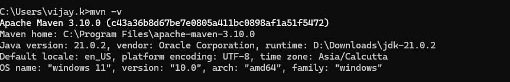
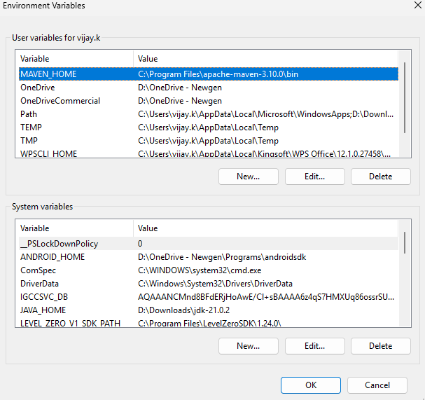

1. I installed the java jdk 25 on my system.
2. I downloaded the mvn setup from th apache website and extrack it then set environmental variable MAVEN_HOME = path till bin 
after setup path i opened the cmd and run cmd 'mvn -v ' but it cant return the maven version.
I checked the steps again i added variable MAVEN_PATH but not add that variable in System 'path' thats why its now returning the version.

3. I create a class LoanInit.java and LoanService with two methods saveLoan and getLoanBalance 
  I compiled java code with the command javac LoanInit.java and ran compiled java class with the command java LoanInit 

Code: 
  import java.util.HashMap;

public class LoanInit {

    public static void main(String[] args) {

          
        LoanService loanService=new LoanService("L01", 10);
         LoanService loanService1=new LoanService("L02", 100);

         try {
             System.out.println(loanService.getLoanBalance("L01"));
             System.out.println(loanService1.getLoanBalance("L02"));
         } catch (Exception e) {
           e.printStackTrace();
         }
        
        
         
    }

    

}

 class  LoanService {

       private HashMap<String, Integer> loan = new HashMap<>();

        public LoanService(String loanId, int loanAmount) throws IllegalArgumentException {

            saveLoan(loanId, loanAmount);

        }

        private void saveLoan(String loanId, int ammount) throws IllegalArgumentException {

            if (loanId.isBlank() || loanId == null) {
                throw new IllegalArgumentException("Loan Id should not be empty.");
            }
            if (ammount <= 0) {
                throw new NumberFormatException("Loan ammount should not be 0 or negative ");
            }

            loan.put(loanId, ammount);
        }

        public int getLoanBalance(String loanId) throws IllegalArgumentException, Exception {

            if (loanId.isBlank() || loanId == null) {
                throw new IllegalArgumentException("Loan Id should not be empty.");
            }

            if (!loan.containsKey(loanId)) {
                throw new Exception("Loan Id not found !");
            }

            return loan.get(loanId);
        }

    }

